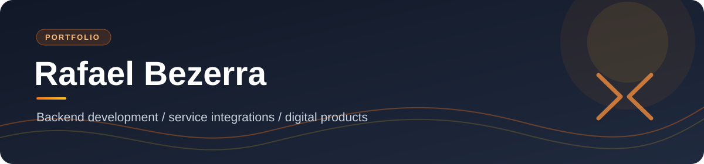

  

  <h1>Hi, I'm Rafael 👋</h1>
  
<strong>Backend Developer at Grupo Boticário</strong>

  
I build service integrations and digital products that make complex systems feel simple.

  

    <a href="https://br.linkedin.com/in/rafaelbezerra195">LinkedIn</a>
    &nbsp;·&nbsp;
    <a href="https://www.culturaemjeri.com.br/">Current project</a>
  

---

## / selected work

### Cultura em Jeri &nbsp; ↗

An interactive cultural map for discovering events and local creators in Jericoacoara. I work on the services and integrations behind the public experience.

**Explore the live product:** [culturaemjeri.com.br](https://www.culturaemjeri.com.br/) 
**Experience:** interactive map · daily events · local cultural profiles

The public product is available to explore. The source repository and internal details remain private.

<!-- When a recording of the CURRENT public interface is available, add a short
     looping GIF here, linked to the live site. Review every frame for personal
     data before publishing. Do not use the old social-preview image: it shows
     a previous version of the interface. -->

---

## / about my work

I focus on backend development, service integrations, and the product experiences they enable. I share public outcomes here while keeping private implementation details private.

## / activity

The contribution graph below is my GitHub activity. GitHub can also count private contributions without naming their repositories when that setting is enabled.

## / let's connect

[LinkedIn](https://br.linkedin.com/in/rafaelbezerra195) · [GitHub](https://github.com/rafaelbezerra195)
